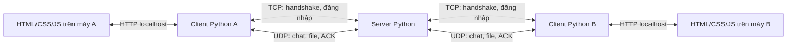

# UDP Stream Collab

Bài tập lớn **Distributed and Streaming-based Client-Server Collaboration
Application**: đăng nhập, xem người đang online, chat chung, chat riêng và
truyền file tin cậy qua UDP trong mạng LAN.

**Thành viên:** Nguyễn Việt Khoa và Hải.

**Cập nhật:** 24/10/2026.

**Định hướng:** làm đơn giản, bám đề và phản hồi giảng viên; ưu tiên chạy đúng,
kiểm thử được và giải thích được code.

> **Dự án đang phát triển.** Đã có model, mock, chia file và một số chức năng
> client/file local. Server TCP/UDP, transport tin cậy và HTTP bridge còn TODO.
> Hiện chạy được các demo bên dưới; chưa có ứng dụng chat/file hoàn chỉnh qua
> mạng thật. Phần “thiết kế” không đồng nghĩa với phần “đã triển khai”.

## 1. Yêu cầu BTL và phạm vi thực hiện

Nguồn: [đề BTL, 4 trang](<Assignment 1 - Distributed Streaming-based Client-Server Collaboration Application (1).pdf>).
Các điều chỉnh từ giảng viên dưới đây là phản hồi do Khoa cung cấp, đã ghi nhận
trong README ngày 21/10/2026.

| Yêu cầu | Căn cứ trong đề | Cách thực hiện của nhóm |
|---|---|---|
| Handshake TCP | Bước 2 | Client kết nối TCP và nhận phản hồi server |
| Đăng nhập, quản lý online | Mục 4; bước 3 | Tài khoản demo tạo trước, session và địa chỉ client |
| Chat chung và chat riêng | Mục 4 nêu broadcast/global chat và unicast/private messaging; bước 5 nêu routing | Server chuyển tiếp đến các client online hoặc một người cụ thể |
| Truyền file qua UDP | Bước 6 | Chia chunk, truyền, ghép lại và kiểm tra toàn vẹn |
| Sequence, ACK, gửi lại, sliding window, flow control | Mục 6 | Tự triển khai trong transport dùng chung |
| Congestion control | Mục 6 | Chọn CUBIC giản lược theo phạm vi được cho phép |
| Đồng thời, tránh chặn giữa các stream | Mục 6–7; bước 4 | Async I/O, stream riêng và hàng đợi có giới hạn |
| 10–20 client đồng thời | Mục 7 | Kiểm thử online/chat và hoạt động đồng thời |
| Timeout, ngắt kết nối và lỗi mạng | Mục 4; bước 7 | Báo lỗi, dọn tài nguyên, không làm server crash |
| Bảo mật | Mục 4, 6; bước 8 | Theo phạm vi điều chỉnh; vẫn kiểm tra đăng nhập, phiên và đầu vào |
| HTTP/JavaScript UI | Bước 9 | HTML, CSS, JavaScript thuần và HTTP bridge cục bộ |
| Kiểm thử, chất lượng code, báo cáo | Bước 10; mục 10 | Kết quả thật, README chạy đúng và báo cáo PDF |

### Phản hồi giảng viên đã ghi nhận

- **Dùng cả TCP và UDP.** Nhóm chọn TCP cho handshake/đăng nhập, UDP cho chat/file.
- **Python được dùng thư viện nhưng không dùng framework.** Ưu tiên socket và
  thư viện chuẩn; không dùng Flask, Django hoặc FastAPI.
- **Không dùng WebSocket** theo giới hạn networking của đề.
- UI được dùng thư viện JavaScript; nhóm chọn **HTML/CSS/JavaScript thuần** để
  dễ làm và giải thích. Không cần trang trí cầu kỳ.
- **BBR/CUBIC được giản lược**, nhưng phải mô tả đúng cơ chế đã làm và đo kết quả.
- **Có thể không mã hóa payload**, nhưng vẫn cần các biện pháp bảo mật khác.
  Không suy ra rằng được bỏ toàn bộ bảo mật hoặc tự khẳng định đạt điểm bước 8.

Đề có chỗ mô tả TCP/UDP và CLI/GUI chưa thống nhất. Nhóm theo phản hồi đã ghi
nhận và các mốc chấm điểm: có handshake TCP, file qua UDP và giao diện HTTP/JS.
Việc phân TCP cho đăng nhập, UDP cho chat/file là thiết kế của nhóm.

### Phạm vi đơn giản

- Một server trung tâm; người dùng nhập địa chỉ server. Server cung cấp danh
  sách online, chưa thêm dò tìm server bằng broadcast LAN.
- Tài khoản demo tạo trước; không làm đăng ký, quên mật khẩu hoặc quản trị user.
- Có chat chung và chat riêng; không thêm phòng chat, đã đọc, đang gõ hoặc
  lịch sử được lưu sau khi đóng chương trình.
- Gửi file cho **một người nhận đang online**. Client nhận file **tự động** nếu
  metadata hợp lệ và có khả năng lưu; không cần người dùng bấm Accept/Reject.
- Giữ `FILE_ACCEPT` làm xác nhận kỹ thuật **“client đã sẵn sàng nhận”**, do
  chương trình tự gửi. Đây không phải bước xin phép người dùng.
- Session lưu trong RAM, file nhận lưu trên đĩa; không thêm database, cloud,
  audio/video hoặc resume file sau restart.
- Không bắt buộc thêm `MSG_DELIVERED`, API `Transport.release()` hay các lớp
  quản lý mới chỉ vì chúng từng xuất hiện trong bản đề xuất chi tiết.

**Đề yêu cầu chat chung; đề không yêu cầu nút chấp nhận file.** Tên các gói file,
SHA-256, cổng và kích thước chunk là lựa chọn triển khai của nhóm.

## 2. Kiến trúc tổng thể



| Thành phần/kênh | Vai trò |
|---|---|
| Server Python | Quản lý user/session/online và chuyển tiếp dữ liệu |
| Client Python | Kết nối server, xử lý chat/file, dùng transport, phát event cho UI |
| Browser | Hiển thị và nhận thao tác; không trực tiếp mở socket UDP |
| TCP server, mặc định 9000 | Handshake, đăng nhập, thiết lập phiên |
| UDP server, mặc định 9001 | Chat, file, ACK, heartbeat, cập nhật online |
| HTTP bridge, chỉ nghe `127.0.0.1` | Phục vụ UI và gọi client core; cổng sẽ cấu hình khi triển khai |

Mỗi người dùng chạy client Python và browser trên cùng máy. HTTP là cầu nối
cục bộ; client Python vẫn dùng TCP/UDP để trao đổi với server. Server chuyển
các chunk, không cần lưu nguyên file. Thử nhiều client trên một máy thì mỗi
client dùng cổng HTTP riêng.

UI dùng **HTTP polling** để nhận event trong bản đầu, chưa cần long-polling.
Network, xử lý dữ liệu và UI được tách riêng. Đọc/ghi file hoặc đợi ACK không
được làm đứng giao diện hay chặn các cuộc trò chuyện khác.

## 3. Cấu trúc code và phân công

| Thư mục | Trách nhiệm | Phụ trách chính |
|---|---|---|
| `common/` | Packet, codec, cấu hình và hợp đồng Transport | Hải; hai người thống nhất API |
| `server/` | TCP, auth, session, heartbeat, online, routing | Hải |
| `transport/` | UDP, sequence, ACK, retry, flow/congestion control | Hải |
| `client/` | Login, chat, chia/ghép file và event | Khoa |
| `ui/` | HTTP bridge, HTML/CSS/JavaScript | Khoa |
| `security/` | Khung bảo mật theo phạm vi thực tế đã chọn | Cả hai phối hợp |
| `mocks/`, `scripts/` | Mock và demo phát triển | Cả hai |
| `docs/`, `reports/` | Đặc tả, kiểm thử và báo cáo | Cả hai |
| `data/` | Dữ liệu thử và file nhận | Dữ liệu cục bộ |

Trong comment/TODO cũ: **A / Bạn A là Hải**, **K / Khoa là Khoa**. Giữ cấu trúc
hiện có khi vẫn đủ rõ; không cần tách thêm nhiều module chỉ để hoàn thiện sơ đồ.
Hai người dùng chung [Packet](common/models.py) và [Transport](common/contracts.py).

| API Transport | Hợp đồng |
|---|---|
| `await start()` | Mở tài nguyên nhận/gửi |
| `await send(peer, packet)` | Bản thật chờ ACK chặng kế tiếp hoặc báo lỗi; mock chỉ đưa vào queue |
| `await receive()` | Trả ReceivedPacket; transport tự xử lý ACK, dedup và thứ tự |
| `await close()` | Đóng tài nguyên, phối hợp dừng task nhận/gửi |

`peer` là địa chỉ socket chặng kế tiếp, còn `packet.recipient` là người nhận
nghiệp vụ. Client gửi đến server; server tra phiên để chọn đích chuyển tiếp.

## 4. Luồng hoạt động

Các luồng dưới đây là hướng triển khai; mục 7 ghi riêng phần đã có code.

### Đăng nhập và online

1. Người dùng nhập server, username và password trên UI.
2. Client kết nối TCP, handshake và gửi yêu cầu đăng nhập.
3. Server kiểm tra tài khoản, từ chối thông tin sai hoặc username đang sử dụng.
4. Server tạo session; client dùng `BIND` để gắn UDP endpoint với phiên hợp lệ.
5. Sau khi thiết lập thành công, client xuất hiện trong danh sách online và
   được gửi/nhận dữ liệu nghiệp vụ.
6. Heartbeat cập nhật hoạt động. Logout hoặc hết timeout làm server xóa phiên
   và gửi danh sách online mới cho các client còn lại.

TCP dùng prefix độ dài 4 byte big-endian và body JSON UTF-8. Phải đọc đủ prefix
và body, giới hạn kích thước và xử lý EOF; không coi một lần `recv()` là một
thông điệp hoàn chỉnh.

### Chat

1. UI gửi `{recipient, text}` cho client Python.
2. Client kiểm tra nội dung, tạo `MSG` và gửi đến server.
3. Server xác định sender từ phiên hợp lệ, kiểm tra người nhận rồi chuyển tiếp.
4. `recipient="*"`: gửi đến các client online khác; người gửi hiển thị bản tin
   của mình. Username cụ thể: chỉ gửi đến người đó.
5. Client nhận phát event `message`; UI hiển thị nội dung bằng `textContent`.

Tin nhắn giới hạn **480 byte UTF-8**, không phải 480 ký tự. ACK từ server chỉ
xác nhận chặng đến server, không chứng minh người nhận đã nhận/đọc. Nếu đích
không tồn tại hoặc chuyển tiếp thất bại, server báo lỗi về người gửi. Một đích
chậm không được chặn việc chuyển tin đến các đích khác.

### File tự động nhận

```text
Client gửi                 Server                  Client nhận
    |--- FILE_META ---------->|--- FILE_META ---------->|
    |                         |          kiểm tra metadata,
    |                         |          chuẩn bị file .part
    |<-- FILE_ACCEPT ---------|<-- FILE_ACCEPT ---------|
    |--- FILE_CHUNK ---------->|--- FILE_CHUNK --------->|
    |          nhiều chunk; mỗi chặng có ACK/retry      |
    |--- FILE_END ----------->|--- FILE_END ----------->|
    |                         |          kiểm tra size/hash,
    |                         |          đổi tên file tạm
    |<-- FILE_COMPLETE -------|<-- FILE_COMPLETE -------|
```

- Metadata gồm tên, số byte, SHA-256, kích thước chunk và tổng số chunk.
- Client nhận kiểm tra và chuẩn bị nơi lưu rồi **tự trả FILE_ACCEPT**. Metadata
  sai, vượt giới hạn hoặc không lưu được thì trả `ERROR`; không hiện hộp Accept.
- Mỗi file có transfer ID riêng; chunk đánh chỉ số từ 0.
- Ghi vào `.part`, xử lý chunk trùng/sai thứ tự; chỉ đổi tên khi đủ dữ liệu và
  size/hash đúng. File rỗng có 0 chunk nhưng vẫn có META/ACCEPT/END/COMPLETE.
- Sender chỉ báo **hoàn tất** sau `FILE_COMPLETE` hợp lệ từ người nhận. Đủ ACK
  đến server thì vẫn đang chờ xác nhận cuối; tiến độ phải phản ánh đúng ý nghĩa đó.
- Lỗi/timeout phải báo thất bại, giải phóng tác vụ và dọn file tạm theo chính
  sách; không báo thành công giả hoặc chờ vô hạn.

## 5. UDP tin cậy và xử lý đồng thời

Đây là phần cốt lõi cần giữ đầy đủ dù nghiệp vụ và giao diện được giản lược.

| Cơ chế | Cần đạt |
|---|---|
| Sequence | Theo từng chặng, phiên, hướng và stream; không dùng một dãy cho tất cả |
| ACK | Xác nhận gói được nhận/giữ hợp lệ; ACK không đòi ACK tiếp |
| Retry | Gửi lại gói chưa ACK khi timeout, có giới hạn số lần |
| Dedup/order | ACK lại gói trùng nhưng chỉ giao nghiệp vụ một lần; giữ thứ tự trong stream |
| Sliding window | Cho phép nhiều gói đang chờ ACK, số lượng hữu hạn |
| Flow control | Sender tuân khả năng nhận để không làm tràn buffer |
| Congestion control | Điều chỉnh lượng dữ liệu gửi theo tình trạng đường truyền |
| Stream riêng | Chat, điều khiển và mỗi file không phải đợi sequence của nhau |

Chọn hướng **Selective Repeat** cho gửi lại và **CUBIC giản lược** cho congestion.
CUBIC cần thể hiện cửa sổ tăng theo hàm bậc ba của thời gian, phản ứng loss và
xử lý timeout. Fixed window hoặc chỉ retry chưa phải CUBIC. Ghi rõ phần giản
lược và đo kết quả; tham khảo [RFC 9438](https://www.rfc-editor.org/rfc/rfc9438.html).

Các quy ước đã chốt và việc cần làm khi ghép:

- `Packet.recv_limit` báo sequence tối đa được nhận, đơn vị packet, trên ACK
  và `WINDOW_UPDATE`; `WINDOW_PROBE` hỏi lại khi hết credit hoặc mất cập nhật.
  Hợp đồng chi tiết ở [protocol mục 6](docs/01_PROTOCOL.md#6-flow-control-đã-chốt-recv_limit-theo-packet);
  model/config đã có, hành vi flow control trong transport vẫn cần triển khai.
- Stream kết thúc trả buffer ACTIVE, giữ dấu CLOSED nhỏ đến hết phiên; quy
  ước quota/lifecycle ở protocol mục 6.1, Hải còn triển khai và kiểm thử.
- `register_peer(peer, session_id)` không còn yêu cầu khóa; client gọi sau
  AUTH_OK, server gọi sau BIND hợp lệ. Hàm đăng ký và mạng thật vẫn TODO.
- Một vòng nhận ở mỗi client dispatch chat/user/file/error. Không để từng tác
  vụ chờ file tự tranh `receive()` rồi lấy mất gói của nhau.
- `send()` thật chờ ACK; gọi tuần tự từng chunk sẽ thành stop-and-wait. Dùng số
  tác vụ gửi có giới hạn, không tạo task cho toàn bộ file lớn.
- Đọc/ghi/băm file, queue UI và queue chuyển tiếp không được chặn vòng nhận mạng.
  Giới hạn buffer/task và có cách xử lý khi đầy; không ACK dữ liệu đã bị bỏ.
- Nhiều stream cùng peer dùng chung ngân sách congestion phù hợp. ACK trùng
  không làm tăng progress hoặc cửa sổ nhiều lần.

Cấu hình trong [common/config.py](common/config.py) là giá trị khởi đầu của nhóm,
chưa được tối ưu qua đo và không phải ngưỡng bắt buộc của đề:

| Cấu hình | Giá trị |
|---|---|
| TCP / UDP server | 9000 / 9001 |
| Datagram tối đa | 1200 byte |
| Body JSON (bản đầu không có envelope mã hóa) | 1100 byte |
| Payload/chunk tối đa | 480 byte |
| Record TCP tối đa | 64 KiB |
| Heartbeat / offline timeout | 3 giây / 10 giây |
| Retry timeout ban đầu / retry tối đa | 0,5 giây / 8 lần |
| Cửa sổ congestion khởi đầu | 8 packet |
| Cửa sổ nhận mỗi stream | 8 packet |
| Nhịp probe / timeout không tăng credit | 1 giây / 10 giây |
| Tổng stream có buffer mỗi transport | 128 |

Bản đầu không có envelope mã hóa; codec phải đo byte sau serialize thực tế.
Payload nhỏ không tự bảo đảm cả datagram vừa giới hạn. Metadata, user list và lỗi cũng phải vừa
gói; danh sách online cần chia trang khi vượt giới hạn.

## 6. Bảo mật trong phạm vi đơn giản

Mã hóa payload được để ngoài phạm vi đầu theo phản hồi đã ghi nhận. Các phương
án TLS/HMAC/AES-GCM trong tài liệu đề xuất trước đây **không tự trở thành yêu cầu
bắt buộc** của bản đơn giản này. Nếu chọn thêm thì phải triển khai, kiểm thử và
mô tả đúng phạm vi bảo vệ.

Những việc vẫn cần làm:

- Kiểm tra tài khoản; không lưu mật khẩu plaintext trong file tài khoản, dùng
  hàm băm mật khẩu có salt bằng thư viện phù hợp. Không log password/khóa.
- Session ID khó đoán, có vòng đời; gắn UDP endpoint với phiên đăng nhập hợp lệ.
  Server kiểm tra phiên/quyền gửi, không tin `sender` tự khai.
- Giới hạn kích thước, kiểm tra kiểu/loại packet, recipient và lượng tài nguyên.
- Tên file không được ghi ra ngoài thư mục nhận hoặc ghi đè file có sẵn.
- HTTP bridge chỉ nghe localhost, kiểm tra truy cập API cục bộ và giới hạn upload.
- Lỗi ghi, hash sai hoặc timeout phải có thông báo và giải phóng tài nguyên.

Session ID, kiểm tra endpoint và SHA-256 **không thay thế mã hóa/xác thực mật mã**.
Nếu chưa bảo vệ kênh đăng nhập hoặc xác thực packet bằng mật mã thì ghi rõ giới
hạn; không tuyên bố chống nghe lén hay giả mạo chủ động. Phần bảo mật hiện chưa
được nghiệm thu.

## 7. Trạng thái code trong cây nguồn hiện tại

| Thành phần | Trạng thái |
|---|---|
| Packet, MessageType, Transport, mock | Có; model thêm recv_limit và WINDOW_UPDATE/PROBE |
| Chia file, build_metadata, FileReceiver | Có xử lý local: metadata/hash/quota, ghép/dedup, cancel/expire/close |
| ClientService.send_chat và event MSG/USER_LIST | Có, chạy qua mock; ERROR của chat chưa ghép |
| ClientService nhận META/CHUNK/END/CANCEL | Có worker ghi/kiểm tra/dọn file, phản hồi/cache; snapshot byte đã ghi, hoàn tất/lỗi/hủy/hết hạn; báo ERROR chủ động khi expire |
| ClientService.send_file | Có luồng gửi, ERROR/CANCEL, tối đa 8 chunk đồng thời; snapshot tiến độ/trạng thái qua poll_file_updates; đã thử với bên nhận qua mock |
| Demo mock/chat/online/file local, demo_client_file_offer/receive/send | Có trong cây nguồn |
| register_peer(peer, session_id) | Chữ ký đã bỏ khóa; xử lý đăng ký vẫn TODO |
| Login, codec, server/auth/session/router | TODO |
| Reliable UDP, flow control, CUBIC giản lược | Hợp đồng đã chốt; xử lý mạng vẫn TODO |
| UI và bridge | HTML/JS fixture, nút disabled; bridge TODO |
| PayloadCipher | Stub tùy chọn ngoài phạm vi bản đầu |

Đây là mô tả source đi cùng README, không phải tuyên bố GitHub main đã được
cập nhật hoặc toàn bộ K2/K3/K4 đã xong. Lịch sử GitHub/local và kết quả kiểm tra
theo phiên bản được tách sang [nhật ký tiến độ](docs/06_TIEN_DO.md). Bản xem thử
trong `output/` không phải UI đã nối vào ứng dụng.

## 8. Cài đặt và chạy phần hiện có

Yêu cầu **Python 3.11+** và Git. Chạy lệnh ở thư mục gốc project. Các demo hiện
có chỉ dùng thư viện chuẩn, chưa cần `cryptography`.

### Lấy code và tạo môi trường

Nếu chưa có repo:

```bash
git clone https://github.com/nvkhoa1207/udp-stream-collab.git
cd udp-stream-collab
```

Nếu đã có repo, mở terminal ở thư mục hiện có; không clone đè hoặc reset phần
đang làm để lấy tài liệu mới.

macOS/Linux:

```bash
python3 -m venv .venv
source .venv/bin/activate
python --version
```

Windows PowerShell:

```powershell
py -3 -m venv .venv
.venv\Scripts\Activate.ps1
python --version
```

Nếu PowerShell không cho chạy script activate, dùng trực tiếp
`.venv\Scripts\python.exe` thay cho `python` trong các lệnh demo.

`requirements.txt` hiện không có dependency bắt buộc ngoài thư viện chuẩn.
AES-GCM/cryptography là mở rộng tùy chọn; chỉ bổ sung khi thực sự triển khai.
Lệnh cài dependency (hiện không cài thêm gói):

```bash
python -m pip install -r requirements.txt
```

### Demo mock và chia file

```bash
python -m scripts.demo_mock
python -m scripts.demo_file_chunks
```

| Demo | Kết quả mong đợi | Phạm vi |
|---|---|---|
| demo_mock | In `OK hợp đồng mock` | Chuyển Packet qua queue trong một process; không gọi ClientService |
| demo_file_chunks | Chunk 480, 480, 40 byte; `Hash giống nhau: True` | Chia/ghi nối tiếp file 1000 byte; không gọi FileReceiver |

`demo_file_chunks` tạo/ghi đè `data/demo_original.bin` và `data/demo_copy.bin`.
Đây là file thử của demo, không dùng chúng để giữ dữ liệu riêng.

### Demo client chat, danh sách online và FileReceiver

Các script đi cùng phần client/file trong cây nguồn này. Khi ghép, Khoa và Hải
dùng cùng nhánh/commit theo [quy trình Git](docs/03_GIT_WORKFLOW.md).

```bash
python -m scripts.demo_client_chat
python -m scripts.demo_client_users
python -m scripts.demo_client_file_offer
python -m scripts.demo_client_file_receive
python -m scripts.demo_client_file_send
python -m scripts.demo_client_file_control
python -m scripts.demo_client_receive_status
python -m scripts.demo_file_receiver
```

| Demo | Kết quả mong đợi | Phạm vi |
|---|---|---|
| demo_client_chat | friend nhận tin từ khoa | Gọi send_chat, receive_events và event queue; server vẫn chuyển tiếp giả |
| demo_client_users | Nhận chat khi còn thiếu trang; đủ trang mới phát `khoa, hai` | USER_LIST qua mock; chưa có server phát danh sách qua UDP |
| demo_client_file_offer | META hợp lệ → ACCEPT; tên sai → ERROR; dừng client dọn .part/quota | Mock và thư mục tạm, chưa gửi CHUNK/END |
| demo_client_file_receive | Nhận 1000 byte qua CHUNK 2,0,0,1; END → COMPLETE, bytes/hash đúng; END lặp không tạo thêm file | Toàn nhánh nhận qua mock và thư mục tạm; chưa gọi send_file hoặc dùng UDP |
| demo_client_file_send | Gọi send_file, truyền 5120 byte tới ClientService bên nhận, COMPLETE đúng size/hash | Hai client và relay bộ nhớ, thư mục tạm; chưa có socket/ACK thật |
| demo_client_file_control | 100% vẫn verifying; COMPLETE mới completed; hủy tại 1920/5120 byte dọn .part/quota, giữ file đã hoàn tất | Mock cố ý chặn chunk/COMPLETE để minh họa progress và CANCEL; không có ACK thật |
| demo_client_receive_status | Nhận 0/40/520/1000 byte, bỏ trùng; completed, expired và failed khi sai hash | Mock/thư mục tạm, đồng hồ giả cho timeout; không có UDP thật |
| demo_file_receiver | Thứ tự `2, 0, 0, 1`, có 3 chunk khác nhau; hash khớp | Dùng FileReceiver để thử chunk trùng/sai thứ tự trên đĩa |

`demo_file_receiver` tạo/ghi đè `data/demo_original.bin`, lưu kết quả ở
`data/received/`, mỗi lần chạy dùng transfer ID mới. Các demo này **không mở
socket TCP/UDP**, không kiểm tra mất gói hoặc chứng minh truyền qua LAN.

### Entrypoint server/client

Hiện chỉ xem được tham số:

```bash
python -m server.main --help
python -m client.main --help
```

Chạy server hoặc client thật hiện kết thúc với exit code 2 và thông báo chưa
triển khai. Chưa có tài khoản đăng nhập thật, HTTP bridge đang nghe hoặc lệnh
chạy ứng dụng hoàn chỉnh để hướng dẫn. Khi ghép xong, mục này phải được thay
bằng lệnh chạy thật, cách tạo tài khoản demo, địa chỉ UI và cách thử hai máy LAN
đã được kiểm chứng.

### Bố trí demo hai máy sau khi ghép mạng

| Máy Khoa | Máy Hải |
|---|---|
| Server trung tâm + client/bridge + browser | Client/bridge + browser |
| Server bind IP LAN hoặc `0.0.0.0` | Client trỏ IP LAN máy Khoa |
| Client cũng trỏ IP LAN máy Khoa | Browser mở HTTP localhost của máy Hải |

Hai máy là đủ. Bridge của cả hai vẫn chỉ `127.0.0.1`; không dùng `0.0.0.0` cho
bridge. Một máy thử nhiều client cần cổng HTTP riêng. Hiện entrypoint còn TODO,
đây là sơ đồ triển khai; bổ sung lệnh và địa chỉ UI đã kiểm chứng sau khi ghép.

## 9. Kiểm thử và nghiệm thu

### Kết quả kiểm tra theo phiên bản

Lệnh, kết quả local và lịch sử kiểm tra được ghi trong
[nhật ký tiến độ](docs/06_TIEN_DO.md). Bốn demo chỉ dùng mock/đĩa cục bộ; không
chứng minh UDP thật, mất gói, flow control, CUBIC hoặc UI hoạt động. Bảng nghiệm
thu mạng vẫn giữ “chưa chạy” đến khi có kết quả ứng dụng thật.

### Những kiểm thử cần hoàn thành

| Nhóm | Tình huống | Kết quả cần đạt |
|---|---|---|
| Đăng nhập/phiên | Đúng/sai mật khẩu, trùng username, ngắt kết nối | Trạng thái/lỗi đúng; server tiếp tục chạy |
| Online/chat | 3 client, chat chung/riêng | Online cập nhật, private không đến người thứ ba, không nhân đôi tin |
| File | File rỗng, nhị phân, tên tiếng Việt, 1 KiB/1 MiB/10 MiB | Nhận tự động, đúng byte/size/hash, chỉ hoàn tất sau xác nhận cuối |
| Reliability | Mất DATA và ACK, gói trùng/sai thứ tự | Retry đúng, không hỏng dữ liệu, hết retry có lỗi rõ |
| Flow/congestion | Receiver chậm, mất UPDATE/probe, ACK cũ/trùng, loss/delay | Buffer hữu hạn, không vượt recv_limit, mở lại cửa sổ hoặc timeout hữu hạn, log CUBIC |
| Đồng thời | Chat khi file gặp loss; 10 rồi 20 client | Stream tiếp tục hoạt động, đo latency và tài nguyên thực tế |
| Lỗi/bảo mật | Session sai, gói quá lớn, tên chứa `../`, thiếu chunk/hash sai, lỗi ghi | Từ chối phù hợp; không ghi ra ngoài hoặc báo thành công giả |
| UI | Login, online, chat, chọn file, progress và lỗi | Thao tác được, phản ánh core, không đứng khi truyền file |
| Cài đặt | Chạy từ README trên máy còn lại | Làm được từ đầu, không cần chỉ dẫn ngoài README |

Mất gói 5–10%, độ trễ và các kích thước file trên là kịch bản nhóm chọn, không
phải ngưỡng điểm của đề. Dùng socket thật, fault injection có seed; lưu cấu hình,
hash, log và PASS/FAIL. Cập nhật [bảng nghiệm thu](docs/04_ACCEPTANCE.md) bằng kết
quả đã chạy. Các mục AES/tag chỉ áp dụng khi có cơ chế tương ứng, không tự biến
phần mã hóa đã được giản lược thành bắt buộc trở lại.

## 10. Thứ tự triển khai tiếp theo

1. Review/ghép nhánh chứa client/file, hai demo và hợp đồng đã đồng bộ để cả hai
   dùng cùng bản nền. Không mặc định nhánh này đã merge vào main.
2. Triển khai codec, session/BIND và API theo docs/01_PROTOCOL.md, docs/02_API.md;
   recv_limit và probe đã có quy ước, cần code và kiểm thử thực tế.
3. Ghép handshake TCP, đăng nhập, online và chat chung/riêng qua UDP thật.
4. Hoàn thiện ACK/retry/window và file tự động từ META đến COMPLETE.
5. Ghép flow/congestion control, các stream độc lập và HTTP UI đơn giản.
6. Nghiệm thu, sửa lỗi, đo 10–20 client, hoàn thiện hướng dẫn chạy và báo cáo.

Đây là thứ tự phát triển, không thay thế yêu cầu cuối cùng. UDP chưa có đủ
reliability/flow/congestion control chỉ là bản trung gian, chưa phải bản đủ để nộp.

## 11. Một số tình huống khi chạy demo

| Hiện tượng | Cách kiểm tra |
|---|---|
| `No module named scripts...` | Chạy ở thư mục gốc bằng `python -m ...`; kiểm tra hai demo local đã được đồng bộ chưa |
| `NotImplementedError` | Đã gọi phần TODO; xem tiến độ, không coi là lỗi cài thư viện |
| Server/client thoát ngay | Entrypoint chưa triển khai; `--help` chỉ hiển thị tham số |
| UI có dữ liệu mẫu, nút disabled | Fixture chưa có bridge và chưa nối core |
| File thử thay đổi sau demo | Hai demo file có tạo/ghi đè demo_original.bin, như ghi ở mục 8 |

Không cần mở firewall hoặc đổi thiết lập mạng để chạy demo bộ nhớ. Hướng dẫn
cổng/firewall cho LAN sẽ bổ sung cùng lệnh chạy mạng thật sau kiểm thử.

## 12. Tài liệu và bản nộp

| Tài liệu | Nội dung |
|---|---|
| [Giao thức](docs/01_PROTOCOL.md) | Packet và luồng truyền đề xuất |
| [API chung](docs/02_API.md) | Hợp đồng client/server/transport |
| [Thiết kế tổng thể](docs/05_THIET_KE_TONG_THE.md) | Tổng hợp kiến trúc theo cùng phạm vi |
| [Tiến độ và kiểm tra](docs/06_TIEN_DO.md) | Kết quả theo phiên bản, lịch sử local/GitHub |
| [Quy trình Git](docs/03_GIT_WORKFLOW.md) | Nhánh và cách ghép code |
| [Nghiệm thu](docs/04_ACCEPTANCE.md) | Các trường hợp kiểm tra và bằng chứng |
| [TODO Hải](TODO_BAN_A.md) | Server và transport |
| [TODO Khoa](TODO_KHOA.md) | Client, file và UI |
| [Kế hoạch ban đầu](TODO_5_NGAY.md) | Lịch nội bộ, không phải thời hạn đề quy định |
| [Định hướng UI](ui/README.md) | HTTP bridge và giao diện |
| [Dàn ý báo cáo](reports/REPORT_OUTLINE.md) | Nội dung báo cáo PDF |

**README, protocol, API, TODO, tài liệu UI và thiết kế đã được đồng bộ cùng phạm vi.**
FILE_ACCEPT là xác nhận tự động; bridge localhost + polling và CUBIC giản lược
đã chọn; chưa bắt buộc TLS/HMAC/AES, MSG_DELIVERED, Transport.release() hoặc module
mới. Quyết định thiết kế không có nghĩa các TODO đã được triển khai.

Theo đề, nộp ZIP hoặc liên kết GitHub private, chứa:

1. Source client/server và các thành phần cần để chạy.
2. README hướng dẫn cài đặt, chạy server, kết nối client và demo chức năng.
3. Báo cáo PDF: kiến trúc, đặc tả giao thức, sequence diagram cho chat/file và
   khoảng một trang **Challenges & Solutions**. Bổ sung phân công và kết quả
   kiểm thử thật để giải thích phần đã làm.

Trước khi nộp, thử lại trên máy còn lại và kiểm tra hình thức nộp/trạng thái repo.
Không đưa `.venv`, dữ liệu cá nhân, mật khẩu, private key hoặc khóa phiên vào
bản nộp. Báo cáo ghi đúng tính năng đã chạy và giới hạn còn lại.
