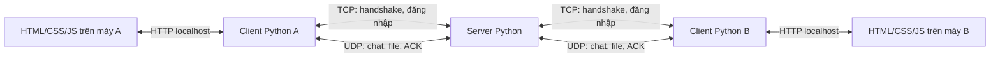

# UDP Stream Collab

Bài tập lớn **Distributed and Streaming-based Client-Server Collaboration
Application**: đăng nhập, xem người đang online, chat chung, chat riêng và
truyền file tin cậy qua UDP trong mạng LAN.

**Thành viên:** Nguyễn Việt Khoa và Hải.

**Cập nhật:** 29/10/2026 — nhánh tích hợp `hai/server-transport`.

**Định hướng:** làm đơn giản, bám đề và phản hồi giảng viên; ưu tiên chạy đúng,
kiểm thử được và giải thích được code.

Giao diện và thông báo chương trình dùng **tiếng Anh**; comment giải thích bằng
**tiếng Việt**. Code UI đã tách hàm và định dạng lại để dễ đọc, xem
[hướng dẫn UI](ui/README.md). Các luồng đăng nhập, chat, tự nhận/hủy file và
thuật toán truyền UDP giữ nguyên.

> **Đã ghép ứng dụng mạng thật.** TCP login, UDP chat/file, Selective Repeat,
> flow control, CUBIC rút gọn và HTTP/UI đã chạy trên Windows loopback.
> 20 client, file tới 16 MiB, 140 file nối tiếp và fault injection đã có kết quả.
> LAN hai máy và Docker/netem chưa chạy; xem mục 9 và báo cáo Hải.

## 1. Yêu cầu BTL và phạm vi thực hiện

Nguồn: [đề BTL, 4 trang](<Assignment 1 - Distributed Streaming-based Client-Server Collaboration Application (1).pdf>).
Các điều chỉnh từ giảng viên dưới đây là phản hồi do Khoa cung cấp, đã ghi nhận
trong README ngày 21/10/2026.

| Yêu cầu | Căn cứ trong đề | Cách thực hiện của nhóm |
|---|---|---|
| Handshake TCP | Bước 2 | Client kết nối TCP và nhận phản hồi server |
| Đăng nhập, quản lý online | Mục 4; bước 3 | Tài khoản demo tạo trước, session và địa chỉ client |
| Chat chung và chat riêng | Mục 4 nêu broadcast/global chat và unicast/private messaging; bước 5 nêu routing | Server chuyển tiếp đến các client online hoặc một người cụ thể |
| Truyền file qua UDP | Bước 6 | Chia chunk, truyền, ghép lại và kiểm tra toàn vẹn |
| Sequence, ACK, gửi lại, sliding window, flow control | Mục 6 | Tự triển khai trong transport dùng chung |
| Congestion control | Mục 6 | Chọn CUBIC giản lược theo phạm vi được cho phép |
| Đồng thời, tránh chặn giữa các stream | Mục 6–7; bước 4 | Async I/O, stream riêng và hàng đợi có giới hạn |
| 10–20 client đồng thời | Mục 7 | Kiểm thử online/chat và hoạt động đồng thời |
| Timeout, ngắt kết nối và lỗi mạng | Mục 4; bước 7 | Báo lỗi, dọn tài nguyên, không làm server crash |
| Bảo mật | Mục 4, 6; bước 8 | Theo phạm vi điều chỉnh; vẫn kiểm tra đăng nhập, phiên và đầu vào |
| HTTP/JavaScript UI | Bước 9 | HTML, CSS, JavaScript thuần và HTTP bridge cục bộ |
| Kiểm thử, chất lượng code, báo cáo | Bước 10; mục 10 | Kết quả thật, README chạy đúng và báo cáo PDF |

### Phản hồi giảng viên đã ghi nhận

- **Dùng cả TCP và UDP.** Nhóm chọn TCP cho handshake/đăng nhập, UDP cho chat/file.
- **Python được dùng thư viện nhưng không dùng framework.** Ưu tiên socket và
  thư viện chuẩn; không dùng Flask, Django hoặc FastAPI.
- **Không dùng WebSocket** theo giới hạn networking của đề.
- UI được dùng thư viện JavaScript; nhóm chọn **HTML/CSS/JavaScript thuần** để
  dễ làm và giải thích. Không cần trang trí cầu kỳ.
- **BBR/CUBIC được giản lược**, nhưng phải mô tả đúng cơ chế đã làm và đo kết quả.
- **Có thể không mã hóa payload**, nhưng vẫn cần các biện pháp bảo mật khác.
  Không suy ra rằng được bỏ toàn bộ bảo mật hoặc tự khẳng định đạt điểm bước 8.

Đề có chỗ mô tả TCP/UDP và CLI/GUI chưa thống nhất. Nhóm theo phản hồi đã ghi
nhận và các mốc chấm điểm: có handshake TCP, file qua UDP và giao diện HTTP/JS.
Việc phân TCP cho đăng nhập, UDP cho chat/file là thiết kế của nhóm.

### Phạm vi đơn giản

- Một server trung tâm; người dùng nhập địa chỉ server. Server cung cấp danh
  sách online, chưa thêm dò tìm server bằng broadcast LAN.
- Tài khoản demo tạo trước; không làm đăng ký, quên mật khẩu hoặc quản trị user.
- Có chat chung và chat riêng; không thêm phòng chat, đã đọc, đang gõ hoặc
  lịch sử được lưu sau khi đóng chương trình.
- Gửi file cho **một người nhận đang online**. Client nhận file **tự động** nếu
  metadata hợp lệ và có khả năng lưu; không cần người dùng bấm Accept/Reject.
- Giữ `FILE_ACCEPT` làm xác nhận kỹ thuật **“client đã sẵn sàng nhận”**, do
  chương trình tự gửi. Đây không phải bước xin phép người dùng.
- Session lưu trong RAM, file nhận lưu trên đĩa; không thêm database, cloud,
  audio/video hoặc resume file sau restart.
- Không bắt buộc thêm `MSG_DELIVERED`, API `Transport.release()` hay các lớp
  quản lý mới chỉ vì chúng từng xuất hiện trong bản đề xuất chi tiết.

**Đề yêu cầu chat chung; đề không yêu cầu nút chấp nhận file.** Tên các gói file,
SHA-256, cổng và kích thước chunk là lựa chọn triển khai của nhóm.

## 2. Kiến trúc tổng thể



| Thành phần/kênh | Vai trò |
|---|---|
| Server Python | Quản lý user/session/online và chuyển tiếp dữ liệu |
| Client Python | Kết nối server, xử lý chat/file, dùng transport, phát event cho UI |
| Browser | Hiển thị và nhận thao tác; không trực tiếp mở socket UDP |
| TCP server, mặc định 9000 | Handshake, đăng nhập, thiết lập phiên |
| UDP server, mặc định 9001 | Chat, file, ACK, heartbeat, cập nhật online |
| HTTP bridge, chỉ nghe `127.0.0.1` | Phục vụ UI và gọi client core; cổng sẽ cấu hình khi triển khai |

Mỗi người dùng chạy client Python và browser trên cùng máy. HTTP là cầu nối
cục bộ; client Python vẫn dùng TCP/UDP để trao đổi với server. Server chuyển
các chunk, không cần lưu nguyên file. Thử nhiều client trên một máy thì mỗi
client dùng cổng HTTP riêng.

UI dùng **HTTP polling** để nhận event trong bản đầu, chưa cần long-polling.
Network, xử lý dữ liệu và UI được tách riêng. Đọc/ghi file hoặc đợi ACK không
được làm đứng giao diện hay chặn các cuộc trò chuyện khác.

## 3. Cấu trúc code và phân công

| Thư mục | Trách nhiệm | Phụ trách chính |
|---|---|---|
| `common/` | Packet, codec, cấu hình và hợp đồng Transport | Hải; hai người thống nhất API |
| `server/` | TCP, auth, session, heartbeat, online, routing | Hải |
| `transport/` | UDP, sequence, ACK, retry, flow/congestion control | Hải |
| `client/` | Login, chat, chia/ghép file và event | Khoa |
| `ui/` | HTTP bridge, HTML/CSS/JavaScript | Khoa |
| `security/` | Khung bảo mật theo phạm vi thực tế đã chọn | Cả hai phối hợp |
| `mocks/`, `scripts/` | Mock và demo phát triển | Cả hai |
| `docs/`, `reports/` | Đặc tả, kiểm thử và báo cáo | Cả hai |
| `data/` | Dữ liệu thử và file nhận | Dữ liệu cục bộ |

Trong comment/TODO cũ: **A / Bạn A là Hải**, **K / Khoa là Khoa**. Giữ cấu trúc
hiện có khi vẫn đủ rõ; không cần tách thêm nhiều module chỉ để hoàn thiện sơ đồ.
Hai người dùng chung [Packet](common/models.py) và [Transport](common/contracts.py).

| API Transport | Hợp đồng |
|---|---|
| `await start()` | Mở tài nguyên nhận/gửi |
| `await send(peer, packet)` | Bản thật chờ ACK chặng kế tiếp hoặc báo lỗi; mock chỉ đưa vào queue |
| `await receive()` | Trả ReceivedPacket; transport tự xử lý ACK, dedup và thứ tự |
| `await close()` | Đóng tài nguyên, phối hợp dừng task nhận/gửi |

`peer` là địa chỉ socket chặng kế tiếp, còn `packet.recipient` là người nhận
nghiệp vụ. Client gửi đến server; server tra phiên để chọn đích chuyển tiếp.

## 4. Luồng hoạt động

Các luồng dưới đây đã nối vào ứng dụng; bằng chứng và giới hạn ở mục 9.

### Đăng nhập và online

1. Người dùng nhập server, username và password trên UI.
2. Client kết nối TCP, handshake và gửi yêu cầu đăng nhập.
3. Server kiểm tra tài khoản, từ chối thông tin sai hoặc username đang sử dụng.
4. Server tạo session; client dùng `BIND` để gắn UDP endpoint với phiên hợp lệ.
5. Sau khi thiết lập thành công, client xuất hiện trong danh sách online và
   được gửi/nhận dữ liệu nghiệp vụ.
6. Heartbeat cập nhật hoạt động. Logout hoặc hết timeout làm server xóa phiên
   và gửi danh sách online mới cho các client còn lại.

TCP dùng prefix độ dài 4 byte big-endian và body JSON UTF-8. Phải đọc đủ prefix
và body, giới hạn kích thước và xử lý EOF; không coi một lần `recv()` là một
thông điệp hoàn chỉnh.

### Chat

1. UI gửi `{recipient, text}` cho client Python.
2. Client kiểm tra nội dung, tạo `MSG` và gửi đến server.
3. Server xác định sender từ phiên hợp lệ, kiểm tra người nhận rồi chuyển tiếp.
4. `recipient="*"`: gửi đến các client online khác; người gửi hiển thị bản tin
   của mình. Username cụ thể: chỉ gửi đến người đó.
5. Client nhận phát event `message`; UI hiển thị nội dung bằng `textContent`.

Tin nhắn giới hạn **480 byte UTF-8**, không phải 480 ký tự. ACK từ server chỉ
xác nhận chặng đến server, không chứng minh người nhận đã nhận/đọc. Nếu đích
không tồn tại hoặc chuyển tiếp thất bại, server báo lỗi về người gửi. Một đích
chậm không được chặn việc chuyển tin đến các đích khác.

### File tự động nhận

```text
Client gửi                 Server                  Client nhận
    |--- FILE_META ---------->|--- FILE_META ---------->|
    |                         |          kiểm tra metadata,
    |                         |          chuẩn bị file .part
    |<-- FILE_ACCEPT ---------|<-- FILE_ACCEPT ---------|
    |--- FILE_CHUNK ---------->|--- FILE_CHUNK --------->|
    |          nhiều chunk; mỗi chặng có ACK/retry      |
    |--- FILE_END ----------->|--- FILE_END ----------->|
    |                         |          kiểm tra size/hash,
    |                         |          đổi tên file tạm
    |<-- FILE_COMPLETE -------|<-- FILE_COMPLETE -------|
```

- Metadata gồm tên, số byte, SHA-256, kích thước chunk và tổng số chunk.
- Client nhận kiểm tra và chuẩn bị nơi lưu rồi **tự trả FILE_ACCEPT**. Metadata
  sai, vượt giới hạn hoặc không lưu được thì trả `ERROR`; không hiện hộp Accept.
- Mỗi file có transfer ID riêng; chunk đánh chỉ số từ 0.
- Ghi vào `.part`, xử lý chunk trùng/sai thứ tự; chỉ đổi tên khi đủ dữ liệu và
  size/hash đúng. File rỗng có 0 chunk nhưng vẫn có META/ACCEPT/END/COMPLETE.
- Sender chỉ báo **hoàn tất** sau `FILE_COMPLETE` hợp lệ từ người nhận. Đủ ACK
  đến server thì vẫn đang chờ xác nhận cuối; tiến độ phải phản ánh đúng ý nghĩa đó.
- Lỗi/timeout phải báo thất bại, giải phóng tác vụ và dọn file tạm theo chính
  sách; không báo thành công giả hoặc chờ vô hạn.

## 5. UDP tin cậy và xử lý đồng thời

Phần cốt lõi đã có trong transport dùng chung giữa client và server.

| Cơ chế | Cần đạt |
|---|---|
| Sequence | Theo từng chặng, phiên, hướng và stream; không dùng một dãy cho tất cả |
| ACK | Xác nhận gói được nhận/giữ hợp lệ; ACK không đòi ACK tiếp |
| Retry | Gửi lại gói chưa ACK khi timeout, có giới hạn số lần |
| Dedup/order | ACK lại gói trùng nhưng chỉ giao nghiệp vụ một lần; giữ thứ tự trong stream |
| Sliding window | Cho phép nhiều gói đang chờ ACK, số lượng hữu hạn |
| Flow control | Sender tuân khả năng nhận để không làm tràn buffer |
| Congestion control | Điều chỉnh lượng dữ liệu gửi theo tình trạng đường truyền |
| Stream riêng | Chat, điều khiển và mỗi file không phải đợi sequence của nhau |

Chọn hướng **Selective Repeat** cho gửi lại và **CUBIC giản lược** cho congestion.
CUBIC cần thể hiện cửa sổ tăng theo hàm bậc ba của thời gian, phản ứng loss và
xử lý timeout. Fixed window hoặc chỉ retry chưa phải CUBIC. Ghi rõ phần giản
lược và đo kết quả; tham khảo [RFC 9438](https://www.rfc-editor.org/rfc/rfc9438.html).

Các quy ước đã chốt và việc cần làm khi ghép:

- `Packet.recv_limit` báo sequence tối đa được nhận, đơn vị packet, trên ACK
  và `WINDOW_UPDATE`; `WINDOW_PROBE` hỏi lại khi hết credit hoặc mất cập nhật.
  Hợp đồng chi tiết ở [protocol mục 6](docs/01_PROTOCOL.md#6-flow-control-đã-chốt-recv_limit-theo-packet);
  model, codec và hành vi transport đã ghép/test qua UDP thật.
- Stream kết thúc trả buffer ACTIVE, giữ dấu CLOSED nhỏ đến hết phiên; quy
  ước quota/lifecycle ở protocol mục 6.1 đã triển khai và kiểm thử.
- `register_peer(peer, session_id)` không còn yêu cầu khóa; client gọi sau
  AUTH_OK, server gọi sau BIND hợp lệ. Mapping đăng ký và bootstrap mạng thật đã triển khai.
- Một vòng nhận ở mỗi client dispatch chat/user/file/error. Không để từng tác
  vụ chờ file tự tranh `receive()` rồi lấy mất gói của nhau.
- `send()` thật chờ ACK; gọi tuần tự từng chunk sẽ thành stop-and-wait. Dùng số
  tác vụ gửi có giới hạn, không tạo task cho toàn bộ file lớn.
- Đọc/ghi/băm file, queue UI và queue chuyển tiếp không được chặn vòng nhận mạng.
  Giới hạn buffer/task và có cách xử lý khi đầy; không ACK dữ liệu đã bị bỏ.
- Nhiều stream cùng peer dùng chung ngân sách congestion phù hợp. ACK trùng
  không làm tăng progress hoặc cửa sổ nhiều lần.

Cấu hình trong [common/config.py](common/config.py) là giá trị khởi đầu của nhóm,
chưa được tối ưu qua đo và không phải ngưỡng bắt buộc của đề:

| Cấu hình | Giá trị |
|---|---|
| TCP / UDP server | 9000 / 9001 |
| Datagram tối đa | 1200 byte |
| Body JSON (bản đầu không có envelope mã hóa) | 1100 byte |
| Payload/chunk tối đa | 480 byte |
| Record TCP tối đa | 64 KiB |
| Heartbeat / offline timeout | 3 giây / 10 giây |
| Retry timeout ban đầu / retry tối đa | 0,5 giây / 8 lần |
| Cửa sổ congestion khởi đầu | 8 packet |
| Cửa sổ nhận mỗi stream | 8 packet |
| Nhịp probe / timeout không tăng credit | 1 giây / 10 giây |
| Tổng stream có buffer mỗi transport | 128 |

Bản đầu không có envelope mã hóa; codec phải đo byte sau serialize thực tế.
Payload nhỏ không tự bảo đảm cả datagram vừa giới hạn. Metadata, user list và lỗi cũng phải vừa
gói; danh sách online cần chia trang khi vượt giới hạn.

## 6. Bảo mật trong phạm vi đơn giản

Mã hóa payload được để ngoài phạm vi đầu theo phản hồi đã ghi nhận. Các phương
án TLS/HMAC/AES-GCM trong tài liệu đề xuất trước đây **không tự trở thành yêu cầu
bắt buộc** của bản đơn giản này. Nếu chọn thêm thì phải triển khai, kiểm thử và
mô tả đúng phạm vi bảo vệ.

Các biện pháp đã triển khai trong phạm vi bản đầu:

- Kiểm tra tài khoản; không lưu mật khẩu plaintext trong file tài khoản, dùng
  hàm băm mật khẩu có salt bằng thư viện phù hợp. Không log password/khóa.
- Session ID khó đoán, có vòng đời; gắn UDP endpoint với phiên đăng nhập hợp lệ.
  Server kiểm tra phiên/quyền gửi, không tin `sender` tự khai.
- Giới hạn kích thước, kiểm tra kiểu/loại packet, recipient và lượng tài nguyên.
- Tên file không được ghi ra ngoài thư mục nhận hoặc ghi đè file có sẵn.
- HTTP bridge chỉ nghe localhost, kiểm tra truy cập API cục bộ và giới hạn upload.
- Lỗi ghi, hash sai hoặc timeout phải có thông báo và giải phóng tài nguyên.

Session ID, kiểm tra endpoint và SHA-256 **không thay thế mã hóa/xác thực mật mã**.
Nếu chưa bảo vệ kênh đăng nhập hoặc xác thực packet bằng mật mã thì ghi rõ giới
hạn; không tuyên bố chống nghe lén hay giả mạo chủ động. Phần bảo mật hiện chưa
được nghiệm thu.

## 7. Trạng thái bản tích hợp

- Codec UDP JSON/base64 strict, TCP length-prefix; hash mật khẩu PBKDF2 với salt.
- TCP HELLO/AUTH, phiên chờ BIND, username trùng, timeout và dọn phiên định kỳ.
- UDP cùng socket suốt phiên, BIND idempotent, kiểm tra sender/session/IP/endpoint.
- Selective ACK, retry/backoff hữu hạn, reorder/dedup, receive window 8 packet,
  probe/stall deadline, ACTIVE/DRAINING/CLOSED và tombstone đến hết phiên.
- CUBIC rút gọn dùng byte budget chung mỗi peer, pacing và recovery flight.
- Server relay chat/file, USER_LIST phân trang/revision, heartbeat/offline/logout.
- Client tự nhận file, kiểm tra size/hash, progress, hủy hai chiều; HTTP polling/UI thật.
- Không còn stub trên đường chạy bắt buộc. `security/cipher.py` là mở rộng tùy chọn,
  không được gọi. [Báo cáo Khoa](reports/KHOA_REPORT.md) được giữ nguyên như bàn giao;
  [báo cáo Hải](reports/HAI_REPORT.md) ghi phần ghép và kết quả mạng mới.

## 8. Chạy trên Windows PowerShell

Yêu cầu Python 3.11+ và thư viện chuẩn, không cần framework hoặc dependency bổ sung.
Mở ba cửa sổ PowerShell trong thư mục repo. Dùng Python trong `.venv` trực tiếp,
không cần đổi ExecutionPolicy. Nếu chưa có môi trường: `py -3 -m venv .venv`.
Nhánh đã ghép là `hai/server-transport`, không mặc định `main` đã có code mới.

Cửa sổ 1 — server:

```powershell
.\.venv\Scripts\python.exe -m server.main --host 127.0.0.1 --tcp-port 9000 --udp-port 9001
```

Server hỏi mật khẩu demo cho `hai` rồi `khoa` bằng getpass. Tự đặt mật khẩu
1–128 ký tự; chỉ giữ hash có salt trong RAM. Không đưa password vào lệnh hay file.

Cửa sổ 2 — client Hải:

```powershell
.\.venv\Scripts\python.exe -m client.main --http-port 8000 --received-dir data/received-hai
```

Cửa sổ 3 — client Khoa:

```powershell
.\.venv\Scripts\python.exe -m client.main --http-port 8001 --received-dir data/received-khoa
```

Mở [client Hải](http://127.0.0.1:8000) và [client Khoa](http://127.0.0.1:8001).
Nhập server `127.0.0.1`, TCP `9000`, username và mật khẩu vừa đặt trên server.
Sau BIND mới có online/chat/file. Chọn `Tất cả` để chat chung hoặc username để
chat riêng/gửi file. File tự nhận; không cần bấm Accept. Sender chỉ “Hoàn tất”
sau COMPLETE đúng size/hash; byte ACK đến server chưa chứng minh người nhận đã lưu.
Nút Hủy có ở cả phía gửi và nhận. Ctrl+C đóng từng chương trình.

macOS/Linux dùng `python3 -m venv .venv`, sau đó `.venv/bin/python -m ...` với
cùng tham số. Bản này mới được đo trên Windows/Python 3.13; Docker/Linux chưa chạy.

### Hai máy LAN — chưa nghiệm thu

Máy server chạy `--host 0.0.0.0`. Hai client nhập cùng IP LAN của máy server,
TCP 9000; UDP 9001 được cấp qua AUTH_OK. Mỗi browser vẫn mở `127.0.0.1` trên
máy của mình. Bridge không nghe LAN. Nếu firewall chặn, người vận hành cho phép
Python/server nhận TCP 9000 và UDP 9001 trên mạng Private; không mở HTTP ra LAN.
Chạy thử login, chat chung/riêng, binary 1 MiB, hủy và mất kết nối; so SHA-256
bằng `Get-FileHash -Algorithm SHA256 <file>`, ghi log/kết quả vào nghiệm thu.
Chi tiết [Windows/LAN/Docker](docs/07_WINDOWS_LAN_DOCKER.md).

## 9. Kiểm thử và bằng chứng

```powershell
$env:BTL_NETWORK_TEST = '1'
.\.venv\Scripts\python.exe -m unittest discover -s tests -q
.\.venv\Scripts\python.exe -m scripts.verify_demos
.\.venv\Scripts\python.exe -m scripts.network_acceptance --clients 20 --sizes 1024,1048576,10485760,16777216 --streams 140
.\.venv\Scripts\python.exe -m scripts.network_acceptance --clients 3 --sizes 65536 --streams 2 --loss 0.07 --delay 0.006 --seed 7
```

Nếu không đặt BTL_NETWORK_TEST, một test TCP tùy chọn của Khoa bị skip; các test
TCP/UDP server nhóm vẫn chạy. Các harness tạo tài khoản thử và file trong thư mục
tạm, kiểm tra hash/size/cleanup rồi tự dọn. `verify_demos` chạy 11 lượt demo cũ
trong thư mục tạm, không ghi đè `data/` cá nhân; demo chỉ chứng minh mock/đĩa local.

Kết quả đo Windows loopback (29/10/2026), 20 client trong cùng process:

| Kịch bản | Kết quả |
|---|---|
| Online, broadcast, nhiều sender nhắn riêng cùng đích | PASS, 20 client |
| File 1 MiB / 10 MiB / 16 MiB | Đúng hash/size; 5,809 / 55,780 / 83,699 giây |
| Chat xen các file trên | 10,87 / 12,56 / 19,23 ms trong lần đo |
| Thêm 140 file rỗng nối tiếp | PASS; kết thúc 288 tombstone, không giữ buffer file |
| Đủ quota 4096 file, logout/reconnect cả hai client, file mới | PASS, 109,243 giây; control không bị quota file chặn |
| Sau tải / shutdown | 0 pending, 0 relay transfer, 0 relay failure; state phiên/worker được dọn |
| Fault seed 7, loss 7%, delay/reorder 6 ms, file 64 KiB | PASS, 3,119 giây; 96 drop, 29 duplicate/1145 lượt gửi; chat 154,66 ms |
| Browser và HTTP | Login, online, chat, upload 1200 byte, completed hai phía; hủy sender/receiver đã thao tác |

Số đo chỉ là một lần chạy, không phải percentile, cam kết throughput hoặc số liệu
LAN. Faults được bơm quanh socket write; datagram còn lại đi UDP thật nhưng đây
không phải netem. CUBIC được kiểm tra bằng clock unit test và đường truyền có
loss/delay; không tuyên bố tương đương đầy đủ RFC 9438.

[Bảng T01–T22](docs/04_ACCEPTANCE.md) phân biệt bằng chứng mạng thật, unit test,
mock và phần chưa chạy. Docker CLI có sẵn nhưng Engine không chạy trên máy này;
Compose đã kiểm tra cú pháp. LAN hai máy và cài từ đầu trên máy còn lại chưa chạy.

## 10. Docker/netem chuẩn bị sẵn — chưa chạy Engine

```powershell
docker compose build
docker compose run --rm --service-ports --name btl-server server
# Terminal khác, sau khi bật Docker Desktop/Linux Engine:
docker compose --profile test run --rm netem
```

Server container vẫn hỏi mật khẩu demo; hai client Windows chạy như mục 8.
Service netem chỉ có NET_ADMIN trong container test, áp loss/delay/duplicate/
reorder lên loopback của container rồi chạy client/server thật. Không sửa qdisc
trên host. Hướng dẫn đầy đủ và nguồn tham khảo ở docs/07_WINDOWS_LAN_DOCKER.md.

## 11. Xử lý lỗi thường gặp

| Hiện tượng | Kiểm tra |
|---|---|
| Port đã được dùng | Đóng instance cũ hoặc dùng cổng khác; TCP/UDP server và HTTP client có cờ riêng |
| Login bị từ chối | Kiểm tra tài khoản/mật khẩu, username đã online; chờ hết phiên cũ tối đa 10 giây |
| BIND timeout | Kiểm tra UDP 9001, IP server, firewall; TCP thông chưa có nghĩa UDP thông |
| `Failed to fetch` | HTTP bridge đã dừng hoặc cổng sai; chạy lại client và reload tab để nhận token mới |
| Phiên mất kết nối | Đăng xuất rồi đăng nhập lại; phiên mới dùng ClientService/socket mới |
| File lỗi/hủy | Xem snapshot và cleanup_pending; không suy từ 100% byte ra thành công |
| `No module named ...` | Chạy từ thư mục gốc repo bằng `python -m ...` |

## 12. Tài liệu và bàn giao

[Giao thức](docs/01_PROTOCOL.md), [API](docs/02_API.md),
[thiết kế](docs/05_THIET_KE_TONG_THE.md), [tiến độ](docs/06_TIEN_DO.md),
[Windows/LAN/Docker](docs/07_WINDOWS_LAN_DOCKER.md),
[nghiệm thu](docs/04_ACCEPTANCE.md), [Git workflow](docs/03_GIT_WORKFLOW.md),
[phần Hải](reports/HAI_REPORT.md), [phần Khoa](reports/KHOA_REPORT.md).

Bản đầu chưa có TLS/HMAC/mã hóa payload theo phạm vi nhóm đã chốt. Session/IP/port
và SHA-256 không thay xác thực mật mã. Không commit `.venv`, mật khẩu, file thử
hoặc output sinh ra. Báo cáo Hải là Markdown để ghép với phần Khoa; báo cáo PDF
nhóm cuối cùng và ảnh/LAN từ máy còn lại cần ghép trước khi nộp.
