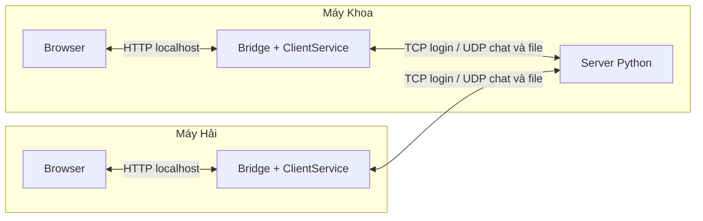
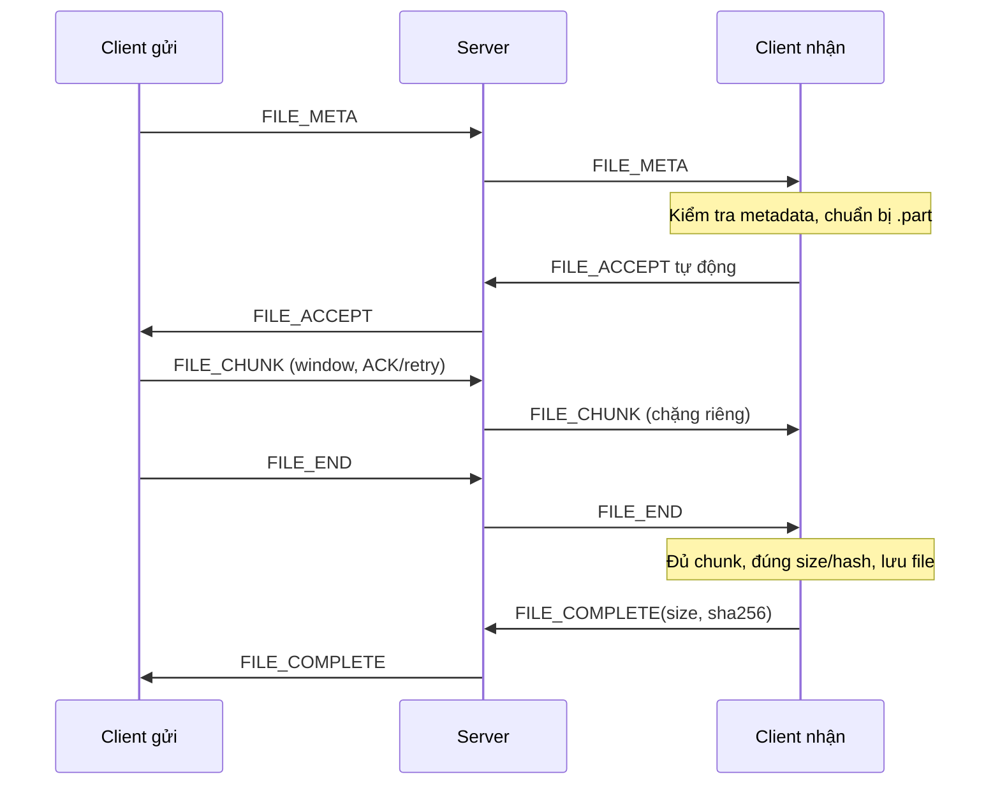

# Thiết kế tổng thể BTL UDP Stream Collab

Cập nhật 23/10/2026 theo [README](../README.md). Tài liệu mô tả đích triển khai;
trạng thái code/kiểm tra ở [tiến độ](06_TIEN_DO.md). Thay thế các đề xuất cũ về
TLS/HMAC bắt buộc, nhận file thủ công, MSG_DELIVERED và Transport.release().
Các phần này không phải điều kiện của bản đầu.

## 1. Phạm vi và hai máy demo

Đăng nhập bằng tài khoản demo tạo trước, online/offline, chat chung/riêng và gửi
file cho một người online. File tự động nhận sau kiểm tra metadata/khả năng lưu.
Một server, session trong RAM, file nhận trên đĩa. Chưa thêm database, đăng ký,
phòng chat, lịch sử sau restart, cloud, audio/video hoặc resume file.

Server và client Khoa là hai tiến trình trên cùng máy. Cả hai client trỏ IP LAN
máy Khoa. Server bind LAN hoặc `0.0.0.0` khi thử hai máy; bridge mỗi máy chỉ nghe
`127.0.0.1`. Thử nhiều client trên một máy thì cổng HTTP khác nhau. Chưa có lệnh
chạy mạng hoàn chỉnh; không cần máy thứ ba hoặc đổi kiến trúc.

## 2. Công nghệ, module và phân công

Python 3.11+, thư viện chuẩn `socket`, `asyncio`/`threading`, `http.server`,
`json`, `base64`, `hashlib`, `secrets`, `pathlib`. Không framework Python hoặc
WebSocket. UI HTML/CSS/JavaScript thuần, `fetch()` polling, chưa cần long-polling.

| Module | Trách nhiệm | Owner |
|---|---|---|
| common | Packet, codec, config, Transport Protocol | Hải, cùng Khoa thống nhất |
| server | TCP/auth, session/BIND/heartbeat, online, routing | Hải |
| transport | UDP, ACK/retry/order, recv_limit, CUBIC giản lược | Hải |
| client | Login, chat, event dispatch, chia/ghép và điều phối file | Khoa |
| ui | HTTP bridge localhost, form/chat/file/progress | Khoa |
| security/cipher.py | Stub AES-GCM tùy chọn, ngoài đường chạy bản đầu | Phối hợp nếu bổ sung sau |
| mocks/scripts | Phát triển và kiểm tra local, không thay kiểm thử mạng | Cả hai |

Giữ cấu trúc hiện tại. Chưa bắt buộc tạo FileManager, TransferRegistry,
EventBuffer hoặc authenticator riêng. Khi code thực tế cần tách mới bổ sung.
Bốn API Transport giữ `start`, `send`, `receive`, `close`; cấu hình riêng của
transport thật là `register_peer(peer, session_id)`, không có tham số khóa.

## 3. Phiên và luồng dữ liệu

Trạng thái: `DISCONNECTED → CONNECTING → AUTHENTICATED → BINDING → ONLINE`.
HELLO/AUTH đi TCP length prefix; AUTH_OK trả session_id và udp_port. Client đăng
ký peer, gửi BIND; server kiểm tra phiên AUTH/nguồn, bind endpoint rồi BIND_OK.
Không tự thay endpoint của phiên đã bind. Logout/heartbeat timeout dọn phiên.
Chi tiết bootstrap, retry và field ở [protocol](01_PROTOCOL.md).

Server lấy sender từ phiên, kiểm tra recipient và quyền gửi. Chat chung fan-out
đến các client khác; private chỉ một đích. Chuyển tiếp giữ message_id, transport
cấp session/seq của chặng đích. Một đích chậm không khóa fan-out hoặc vòng nhận.
ACK server không phải “đã giao/đã đọc”; chưa thêm MSG_DELIVERED.

Không có nút Accept/Reject. Lỗi metadata/lưu file trả ERROR. Tiến độ gửi đếm byte
mới ACK đến server; đủ byte chuyển “chờ xác minh”, chỉ COMPLETE hợp lệ mới thành
“hoàn tất”. File rỗng vẫn có META/ACCEPT/END/COMPLETE. Timeout/hủy/lỗi phải dọn
transfer/tệp tạm và báo đúng trạng thái, không tạo thành công giả.

## 4. Reliability, flow control và CUBIC

- Sequence/ACK/retry/dedup/order riêng theo chặng/phiên/hướng/stream. Selective
  Repeat, cửa sổ hữu hạn, không ACK dữ liệu bị bỏ vì đầy buffer.
- Receiver cấp `recv_limit` theo packet trên ACK/WINDOW_UPDATE; đây là giới hạn
  sequence tuyệt đối tăng dần. Sender chưa có credit thì WINDOW_PROBE xin/hỏi
  lại; mất thông báo mở cửa sổ có probe định kỳ và deadline, không chờ vô hạn.
- `receive()` giao packet đúng thứ tự thì nhả slot và mở cửa sổ; không thêm
  `release()`. App giữ queue/worker hữu hạn để giới hạn cả bộ nhớ ngoài transport.
- Dành buffer trước khi cấp credit; quota số stream/tổng bộ nhớ, trạng thái kết
  thúc/chống trùng và dọn phiên phải được triển khai. Chi tiết và ví dụ ở
  [protocol mục 6](01_PROTOCOL.md#6-flow-control-đã-chốt-recv_limit-theo-packet).
- CUBIC giản lược dùng ngân sách congestion chung mỗi peer/hướng; tăng bậc ba,
  giảm loss/timeout, không đếm ACK trùng. Flow tính packet, congestion tính byte;
  cả hai cùng chặn DATA mới. Cần đo kết quả, fixed window không phải CUBIC.

Hiện chỉ model/enum/config và hợp đồng đã cập nhật; UDP/flow/CUBIC vẫn TODO.

## 5. Đồng thời, backpressure và UI

Một vòng nhận UDP xử lý ACK/window, một consumer nghiệp vụ dispatch chat/user/
file/error. Không để từng transfer tranh receive. Tách stream chat, control và
mỗi file; điều khiển cancel/error không chờ chunk mất.

Tác vụ đọc/ghi/băm file chạy bằng worker hữu hạn, tuần tự hóa trên cùng transfer.
Sender dùng số lệnh send đang chờ hữu hạn, không tạo task cho mọi chunk hoặc
await từng chunk đến ACK rồi mới gửi tiếp. Router dùng queue hữu hạn từng đích;
receiver không nhận trách nhiệm cho dữ liệu đã bỏ. Khi đầy, phải backpressure
hoặc báo lỗi rõ, không ACK thành công giả.

HTTP bridge dùng thread hoặc cơ chế riêng phối hợp event loop; không sửa state
mạng đồng thời thiếu kiểm soát. Polling từ UI lấy event, giới hạn request đang
chờ. Login, online, chat, file picker/progress và lỗi là đủ cho bản đầu.
Xem [UI](../ui/README.md) để ghép endpoint; fixture hiện tại vẫn chưa nối core.

## 6. Bảo mật đúng phạm vi

Bản đầu chưa TLS/HMAC/AES và không cấp khóa hai hướng. `PayloadCipher` là stub
ngoài đường chạy; không thay stub bằng pass-through hoặc tạo khóa giả. Kiểm tra
mật khẩu băm có salt, session/endpoint/quyền gửi, schema/size/quota, đường dẫn
file và API localhost vẫn phải làm. Password AUTH trên TCP chưa được che nội
dung; session ID/endpoint/SHA-256 không chống nghe lén hay giả mạo chủ động.

Nếu bổ sung mật mã sau này phải cập nhật hợp đồng và kiểm thử cả hai đầu, bảo
vệ việc trao đổi khóa và quản lý nonce đúng. Không coi mở rộng này là việc K5
bắt buộc chỉ vì từng nằm trong bản thiết kế trước.

## 7. Mốc ghép và bằng chứng

| Mốc | Đầu ra cần chứng minh |
|---|---|
| Hợp đồng và code nền | Cùng model/API, cả hai có client/file và hai demo local |
| Phiên và chat | TCP login → BIND → UDP chat/online thật giữa các client |
| File và flow | Nhận tự động, hash đúng, retry mất DATA/ACK, phục hồi mất UPDATE |
| Đồng thời và UI | CUBIC giản lược, chat lúc file loss, UI polling, 10–20 client |
| Nghiệm thu và báo cáo | Demo hai máy, README chạy được, log/hash/PASS/FAIL thật |

Các kịch bản ở [nghiệm thu](04_ACCEPTANCE.md). Không suy từ mock ra đã hoàn thành
mạng/bảo mật; không tick mục chưa có bằng chứng. Hướng dẫn Git ở
[quy trình ghép](03_GIT_WORKFLOW.md), tiến độ/lịch sử ở [nhật ký](06_TIEN_DO.md).
