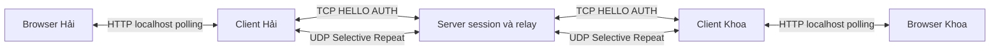

# Phần Hải — server, codec và reliable UDP

Bản tích hợp 29/10/2026 trên nhánh hai/server-transport. Báo cáo này bổ sung
phần Khoa, không sửa reports/KHOA_REPORT.md. Kết quả bên dưới là Windows
loopback, không thay kết quả LAN/netem hoặc báo cáo PDF nhóm cuối cùng.

## 1. Phạm vi đã hoàn thành

Codec Packet JSON/base64 và TCP record length-prefix; HELLO/AUTH với mật khẩu
PBKDF2-HMAC-SHA256 có salt; SessionRegistry, BIND cùng socket UDP, heartbeat,
online/offline/logout; Selective Repeat/ACK/retry/order/flow/CUBIC; relay chat
chung/riêng và file riêng. Đã ghép client, file worker, HTTP polling và UI Khoa.
Không còn NotImplementedError trên đường chạy bắt buộc; cipher là mở rộng ngoài
phạm vi, không được gọi hoặc thay bằng pass-through giả.



TCP 9000 chỉ thiết lập phiên. AUTH_OK tạo phiên chờ BIND, chưa online. BIND
đối chiếu session còn hạn, sender và IP TCP; endpoint lấy từ recvfrom. BIND lặp
cùng endpoint trả lại BIND_OK, không đổi endpoint đã gắn. UDP 9001 mang chat,
file và điều khiển. Browser không trực tiếp mở socket UDP.

## 2. Giao thức và relay

TCP JSON có prefix 4 byte big-endian, body tối đa 64 KiB; đọc đủ frame,
timeout/EOF rõ ràng. Client/server dùng chung reader strict, loại JSON field
trùng. Username ASCII 1–32 ký tự, server dành riêng; password 1–128 ký tự.
PBKDF2 600000 vòng chạy trong thread khi verify; tạo tài khoản production trước
event loop. Không log password/session; chỉ lưu hash/salt và session trong RAM.

UDP datagram tối đa 1200 byte, JSON body 1100 byte, payload thô 480 byte.
Codec kiểm tra type/version/kind, ID hex, base64, sequence, ACK, recv_limit,
chunk_index và kích thước thực sau encode. Datagram lỗi không làm chết vòng nhận.
Session/endpoint/sender được kiểm tra trước ACK. Identity router lấy từ phiên
đã xác thực, không tin tên sender tự khai khi khác phiên.

Server relay giữ message_id, field nghiệp vụ và transfer ID. Transport cấp
session/sequence mới trên từng chặng/hướng/stream. Chat ra ánh xạ sender+stream
bằng hash sang ID ngắn hơn 64 ký tự để nhiều sender không dùng chung sequence.
USER_LIST chia tối đa 8 username/trang, revision tăng theo online; các trang
chưa phát được gộp về revision mới nhất, không bỏ dở một revision do queue đầy.

FILE_META → FILE_ACCEPT tự động → CHUNK → END → FILE_COMPLETE. Server không lưu
nguyên file và không báo hoàn tất vì ACK. Receiver dùng .part, kiểm tra đủ
chunk/size/SHA-256 rồi publish không ghi đè. Sender chỉ completed khi COMPLETE
hợp lệ từ đúng receiver; ACK server chỉ xác nhận chặng đến server.

## 3. Reliability và flow control

Sequence từ 1 theo peer/session/hướng/stream; Selective ACK từng packet.
Receiver giữ reorder buffer, chỉ giao liên tiếp và một lần. Retry của DATA đã
nhận được ACK lại nhưng không giao lại. ACK/window/bootstrap/heartbeat có seq=0
và không yêu cầu ACK tiếp. ACK chỉ giải phóng DATA đã thực sự phát; ACK cho
sequence mới dành trước nhưng chưa có credit bị bỏ qua.

RTO ban đầu 0,5 giây, tối đa 8 retry, backoff chặn ở 4 giây. Hết retry/cancel
làm stream lỗi, không bỏ qua lỗ sequence. Future pending được đánh thức khi
remove peer/close; không tạo task cho toàn bộ file, sender chỉ giữ tối đa 8 send.

Mỗi stream có 8 slot; recv_limit = consumed_seq + 8, là sequence tuyệt đối,
đơn vị packet. Sender bắt đầu limit=0, hỏi bằng WINDOW_PROBE, hợp nhất UPDATE
bằng max. ACK không tạo thêm credit. receive chỉ nhả slot khi giao đúng thứ tự
cho downstream có chỗ. Mất update/probe được hỏi lại tối đa 1 lần/giây; không
tăng credit trong 10 giây khi đang bị chặn thì timeout. Control được dành buffer
trước; packet chưa có buffer/cửa sổ/phiên hợp lệ không được ACK.

Ứng dụng dùng admission hook nội bộ để giữ credit của stream file bị đầy queue,
vẫn lấy packet chat/control khác. Callback datagram tiếp tục ACK/window độc lập
I/O. Worker file dùng to_thread tuần tự; HTTP chạy thread khác và gửi coroutine
vào event loop. Không đọc/băm toàn bộ file trong vòng nhận UDP.

## 4. Vòng đời và giới hạn tài nguyên

ACTIVE giữ buffer/credit; success chuyển DRAINING và đợi send/buffer đã nhận
xả hết; CLOSED chỉ giữ consumed_seq/outcome. ERROR/CANCEL/expire đóng lỗi ngay.
Client/server gọi finish_stream theo kết quả nghiệp vụ sau terminal reply ACK.
Cache COMPLETE/ERROR ở FileOfferReceiver tối đa 120 giây, không gia hạn vì lặp;
tombstone stream giữ tới hết phiên. Packet/probe muộn không tái tạo file.

| Tài nguyên | Giới hạn |
|---|---|
| Session/peer server | 100 |
| Rx buffer ACTIVE/DRAINING trên transport | 128 stream × 8 packet |
| Tx stream / pending send | 512 / 1024 |
| Lịch sử file mỗi peer | 4096 ACTIVE+CLOSED, ngoài control/chat |
| Relay queue / send đang chờ mỗi worker | 16 / 8 |
| Relay worker / transfer server | 256 / 64 |
| Transfer liên quan mỗi phiên server | 4 |
| Reference message ID mỗi transfer | 65540 |
| File / tổng reservation nhận / số lượt nhận | 16 MiB / 64 MiB / 4 |
| Queue file / event client / HTTP ring | 8 / 100 / 512 |
| HTTP background job | 4 |

Server sweep định kỳ 0,1 giây, pending BIND/offline 10 giây. Logout/expire dọn
session/endpoint/state và worker peer; bên còn lại được ERROR/CANCEL để dọn
.part. Relay file không tiến triển 60 giây bị hủy; receiver timeout 45 giây,
sender chờ ACCEPT/COMPLETE 30 giây và mỗi send có deadline 45 giây. Transport
dùng monotonic; test có clock giả cho deadline/quota nhưng không gọi đó là LAN.

## 5. CUBIC rút gọn

Nguồn: [RFC 9438](https://www.rfc-editor.org/rfc/rfc9438.html). Hàm target theo
thời gian từ epoch loss: W(t)=C×(t−K)^3+Wmax, C=0,4, beta=0,7. Cwnd được quản
lý bằng byte, mss quy đổi 1200 byte, ban đầu 9600 byte, trần 307200 byte và sàn
giảm sau loss 2400 byte. Có Reno floor và chặn mức tăng mỗi ACK; mới ACK mới
giảm bytes_in_flight/tăng cwnd. Một controller dùng chung tất cả stream của peer.

Timeout gây giảm cwnd; ticket/recovery_until chặn tính lại loss của cùng flight.
Retransmit không cộng bytes_in_flight lần hai. RTT chỉ lấy từ gói chưa retransmit
(Karn); pacing theo cwnd/RTT, không tích lũy burst vô hạn khi idle. Flow packet
credit và congestion byte budget là hai điều kiện riêng cùng chặn DATA mới.

Phần rút gọn: loss dùng RTO, không fast convergence/HyStart++/ECN, không undo
spurious loss, không đầy đủ TCP Reno-friendly region hoặc idle adjustment của
RFC. Không tuyên bố tương đương TCP CUBIC của hệ điều hành. Test clock chứng
minh target phụ thuộc thời gian, giảm 0,7 và không đếm ACK/loss hai lần; test
socket có delay/loss dùng hai stream chung peer, đếm bytes/ACK/loss thật.

## 6. Kết quả kiểm thử 29/10/2026

Môi trường Windows, .venv Python 3.13.5. Bật BTL_NETWORK_TEST=1: **202 tests PASS,
không skip**; gồm test cũ, codec/auth/session, TCP/UDP thật, selective ACK,
window, CUBIC, team client/server và hai HTTP bridge. 11 lượt demo cũ PASS
trong thư mục tạm; demo chỉ dùng mock/đĩa local. JS node --check và Compose
config --quiet PASS. git diff --check được chạy trước commit.

```powershell
$env:BTL_NETWORK_TEST = '1'
.\.venv\Scripts\python.exe -m unittest discover -s tests -q
.\.venv\Scripts\python.exe -m scripts.verify_demos
.\.venv\Scripts\python.exe -m scripts.network_acceptance --clients 20 --sizes 1024,1048576,10485760,16777216 --streams 140
.\.venv\Scripts\python.exe -m scripts.network_acceptance --clients 3 --sizes 65536 --streams 2 --loss 0.07 --delay 0.006 --seed 7
```

| Kịch bản | Kết quả đo của lần chạy đầy đủ cuối |
|---|---|
| 20 client online/chat | PASS, đạt bước online/chat sau 5,068 s kể cả tạo hash/login |
| 1 KiB / 1 MiB | 0,041 / 5,809 s; 24,3 / 176,3 KiB/s |
| 10 MiB / 16 MiB | 55,780 / 83,699 s; 183,6 / 195,7 KiB/s |
| Chat xen 1 MiB / 10 MiB / 16 MiB | 10,87 / 12,56 / 19,23 ms |
| Thêm 140 file rỗng nối tiếp | PASS, tổng 144 file và 288 tombstone server |
| Sau tải / shutdown | rx 41 control/chat; 0 pending/transfer/failure; phiên/worker dọn sạch |
| Quota 4096 file và reconnect hai phía | PASS, 109,243 s; control/logout vẫn hoạt động |
| Tổng bài tải đầy đủ | PASS, 152,723 s, 376734 lượt ghi packet |
| Seed 7, loss 7%, delay/reorder 6 ms, 3 client | File 64 KiB PASS 3,119 s; chat 154,66 ms |
| Bộ fault trên | 1145 lượt ghi, 96 injected drop, 29 duplicate; 19 loss event CC server |

Số đo một lần chạy, không phải percentile hoặc mô phỏng vật lý mạng LAN.
Fault injector tác động packet quanh socket write, các datagram còn lại đi UDP
loopback thật; khác netem. Tham số retry/probe trong harness giảm còn 40 ms để
kiểm tra nhanh; production vẫn 0,5/1 giây như protocol. Trên đường sạch không
có loss event trong lần stress; đây không phải cam kết không bao giờ mất gói.

Browser hai tab thật đã login/online, gửi chat, upload file 1200 byte và thấy
completed cả hai phía; có ảnh kiểm tra local ngoài Git. Đã bấm Hủy từ sender và
receiver qua HTTP/UI; fixture delay trước send chunk để đủ thời gian thao tác,
vẫn dùng TCP/UDP/ACK thật. Test core E2E xác nhận .part/quota được dọn, gửi tiếp
thành công. Đã sửa UTF-8 HTML/CLI Windows (kể cả pipe cp1252), USER_LIST khi burst login, ERROR thừa sau
CANCEL và thông báo hủy bị trình bày thành lỗi thao tác chung.

## 7. Khó khăn và cách giải quyết

1. Mock không phát hiện lỗi encode/sequence/session của relay. Dùng test client
   nhóm với server nhóm và hai bridge thật; giữ message_id, cấp seq/session theo chặng.
2. ACK giải phóng bytes_in_flight nhưng consumer có thể chưa nhận packet. Tách
   congestion byte budget khỏi recv_limit tuyệt đối; slow consumer giữ credit,
   WINDOW_PROBE khôi phục mất UPDATE, stream khác tiếp tục.
3. Đóng file quá sớm có thể mất COMPLETE ACK hoặc tái nhận META cũ. DRAINING
   đợi pending/buffer, CLOSED giữ sequence; result cache/tombstone có quota riêng.
4. Shutdown/cancel không dừng thread I/O ngay. Client đợi thao tác đĩa hiện tại
   kết thúc trước cleanup; các send/worker/future được cancel/await hữu hạn.
5. Burst 20 login làm queue USER_LIST đầy và thiếu trang revision. Gộp các trang
   chưa phát về revision mới nhất, retry khi queue control có chỗ.
6. Windows đọc HTML bằng codepage mặc định gây 400 dù mock HTTP pass. Test HTTP
   socket thật phát hiện và sửa read_text UTF-8; browser xác minh kết quả.
7. Sandbox Windows kẹt asyncio socketpair trước test. Chạy test có quyền loopback
   ngoài sandbox; phân biệt lỗi môi trường với lỗi implementation, không sửa test né.

## 8. Hạn chế và phần nghiệm thu còn lại

- LAN hai máy và cài từ đầu trên máy Khoa chưa chạy; lệnh/hướng dẫn ở
  docs/07_WINDOWS_LAN_DOCKER.md. Không suy từ 20 instance cùng máy ra LAN PASS.
- Docker CLI có nhưng Linux Engine không chạy; Compose hợp lệ về cú pháp,
  Dockerfile/netem script đã chuẩn bị, chưa build/run hoặc đo kernel netem.
- Kênh TCP AUTH và payload UDP chưa TLS/HMAC/mã hóa theo phạm vi nhóm đã chọn.
  Session/IP/port không xác thực mật mã; SHA-256 chỉ kiểm tra toàn vẹn file,
  không chống kẻ chủ động sửa cả payload/hash. Không có resume qua restart.
- Quota đã chạy đủ 4096 file đầu-cuối, chặn vượt quota, logout/reconnect cả hai
  client và file mới PASS (109,243s). TTL/cache 120s dùng clock unit; chưa giữ
  kết nối LAN 120 giây để kiểm cache. ACK COMPLETE mất và packet muộn đã chạy.
- Báo cáo Hải ở Markdown để ghép phần Khoa; PDF nhóm cuối cùng, ảnh và kết quả
  từ máy LAN còn cần ghép trước khi nộp. Không ghi đè báo cáo Khoa.

## 9. Commit theo giai đoạn

| Giai đoạn | Commit | Nội dung |
|---|---|---|
| 1 | 6d72852 | Merge Khoa 2999d08, strict TCP client và sweep session, test auth thật |
| 2 | 125e0de | UDP socket lifecycle và BIND bootstrap |
| 3 | f3410f6 | Selective ACK/retry/dedup |
| 4 | 1c4c777 | Window/probe/reorder/quota/lifecycle |
| 5 | f7f651f | CUBIC byte budget/pacing |
| 6 | 2ce7432 | Relay chat/file, online/offline và tích hợp client |
| 7 | Commit bàn giao chứa tài liệu này | HTTP/browser, stress/fault harness, hardening và báo cáo |

Các giai đoạn 1–6 đã push origin hai/server-transport. Xem git log và trạng thái
remote của commit bàn giao khi nhận; không merge main hoặc sửa lịch sử đã push.
