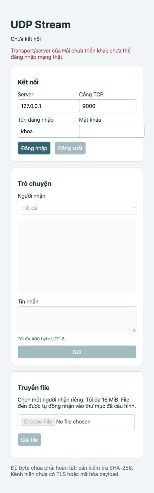

# Phần Khoa — client, file và giao diện

Ngày kiểm tra: 28/10/2026. Nhánh: codex/align-protocol-docs.
Đây là phần báo cáo của Khoa để ghép vào báo cáo nhóm, không phải xác nhận
nghiệm thu toàn bộ BTL. Server/codec/reliable UDP/CUBIC của Hải còn stub.

## Chức năng đã viết

- ClientService: HELLO/AUTH qua TCP record 4 byte độ dài + JSON; validate phiên,
  dùng IP TCP peer/UDP port từ AUTH_OK; đăng ký và BIND cùng transport. Sau
  BIND_OK chạy heartbeat và vòng nhận; logout dừng job, task và đóng transport.
- Chat/online: UTF-8 tối đa 480 byte, phân người nhận; ghép USER_LIST theo
  revision, bỏ trang cũ/trùng, chỉ phát danh sách hoàn chỉnh.
- File: META/ACCEPT, gửi nhóm tối đa 8 chunk; END rồi COMPLETE đúng size/hash.
  Receiver ghi theo chunk_index, chỉ đếm chunk duy nhất, kiểm tra SHA-256,
  dùng .part và publish không ghi đè. Quota file/tổng byte/transfer/chunk hữu hạn.
- Lỗi và hủy: ERROR liên hệ message_id; expire báo FILE_EXPIRED về sender;
  hủy hai chiều qua control, không xóa file đã hoàn tất. Lỗi unlink giữ quota
  để retry; ID/cache tránh packet muộn mở lại file.
- Snapshot hai chiều: sending/receiving/verifying/completed/failed/cancelled/
  expired; đủ byte chưa tự thành completed. Gửi COMPLETE lỗi không xóa file
  cuối và không đổi kết quả lưu file thành thất bại giả.
- HTTP/UI: loopback, Host/Origin/token, không framework/WebSocket; polling cursor,
  ring 512 event, 4 job; upload nhị phân tối đa 16 MiB, tên an toàn, file tạm
  thuộc job và được dọn. HTML/JS dùng textContent, form/login/chat/file/cancel;
  không có fixture hoặc cơ chế tự báo connected khi backend chưa chạy.

## Tách trách nhiệm

Browser gọi HTTP; HTTP thread đưa coroutine vào event loop; ClientService gọi
Transport. Worker đĩa tuần tự không chặn vòng nhận mạng. Hải triển khai socket
UDP, codec, ACK/retry/window/CUBIC và routing. Khoa không tự mở UDP thứ hai khi
BIND, không tự viết lại ACK trong UI/service.

## Kết quả kiểm tra

| Kiểm tra | Kết quả | Giới hạn |
|---|---|---|
| unittest discover toàn bộ | 119 ca: 118 đạt, 1 TCP tùy chọn bị skip | Không mở TCP/UDP trong suite mặc định |
| BTL_NETWORK_TEST=1 test_tcp_auth_network | 1 đạt | TCP loopback thật với server test; không phải server nhóm |
| Runtime upload → hai ClientService → relay mock | Đạt, 3000 byte/hash và cleanup | Không có UDP/ACK/loss thật |
| Các test file/queue/hủy/expire | Đạt, có lỗi đĩa và shutdown giữa I/O | Fault injection có kiểm soát |
| node --check ui/app.js | Đạt | Kiểm tra cú pháp |
| Browser HTTP localhost 18080 | Form hoạt động, thông báo 503 đúng khi login vào transport stub; chat/file khóa | Chưa kiểm tra UI chat/file kết nối server thật |

Ảnh kiểm tra UI thật (username/mật khẩu thử, password đã được xóa khỏi form):



## Chạy lại

```bash
python3 -m unittest discover -s tests -v
BTL_NETWORK_TEST=1 python3 -m unittest discover -s tests -p test_tcp_auth_network.py -v
python3 -m scripts.demo_client_file_send
python3 -m scripts.demo_client_file_control --receiver-cancel
python3 -m scripts.demo_client_receive_status
python3 -m client.main --http-port 8000 --received-dir data/received
```

Mở http://127.0.0.1:8000. Password nhập qua form, không CLI/log. Ctrl+C để đóng.
Hiện login báo transport chưa triển khai là đúng trạng thái repository.

## Những vấn đề đã giải quyết

1. Một vòng nhận phục vụ nhiều chức năng: dispatcher chuyển phản hồi tới lượt
   gửi, không để mỗi file tự receive và lấy mất chat/ACK ứng dụng khác.
2. Hủy coroutine không dừng thread đĩa: chờ I/O xong rồi cleanup trong worker,
   giữ snapshot pending khi cần, không tạo file sau khi đã báo dọn xong.
3. Tiến độ không phản ánh việc lưu file cuối: tách byte ACK tới server, byte đã
   ghi ở receiver và COMPLETE sau size/hash. Cache kết quả chống END lặp.
4. UI chậm: snapshot gộp/hữu hạn, ring có cursor/reset, job/upload có giới hạn;
   báo lịch sử bị lược bỏ, không giả vờ giữ toàn bộ lịch sử chat.

## Việc chưa thể nghiệm thu độc lập

K7 cần Hải hoàn thiện start/register_peer/send/receive/close, bootstrap BIND,
codec/router/auth/heartbeat/USER_LIST và hook đóng stream. Sau đó thử hai máy,
chat và file cùng lúc, mất DATA/ACK/UPDATE, 10–20 client, >128 stream nối tiếp,
CUBIC theo số liệu thật. Không được tick các ca này từ mock. Báo cáo PDF nhóm
cần ghép phần Hải và kết quả đo mạng sau khi có triển khai thật.

Giới hạn hiện tại: TCP AUTH chưa TLS, UDP chưa xác thực mật mã; session/hash
không thay HMAC/mã hóa. HTTP server xử lý tuần tự, upload có thể làm polling
chờ nhưng không chặn event loop core; chưa đo tải HTTP với nhiều trình duyệt.
